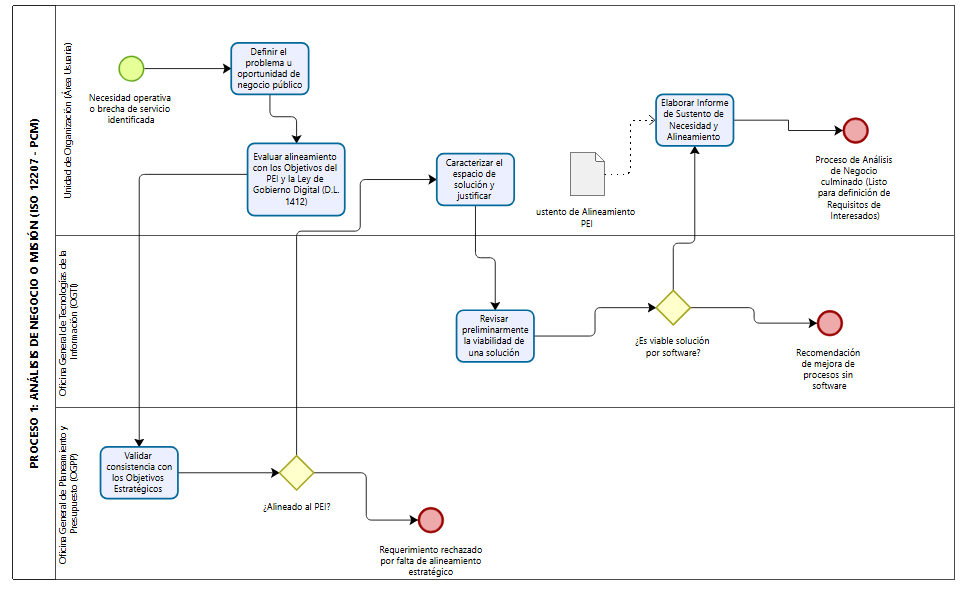
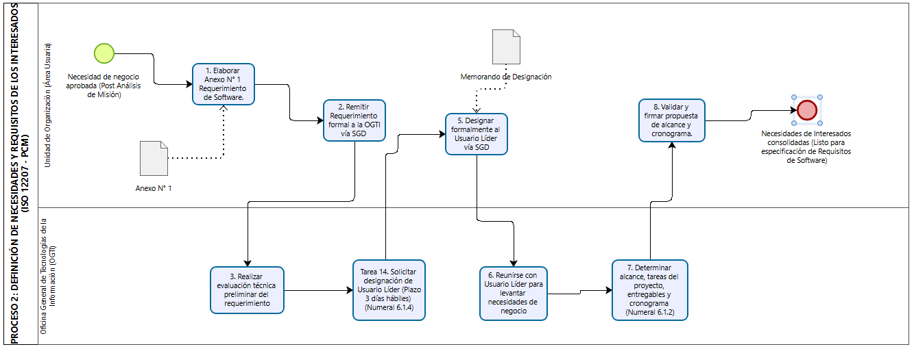
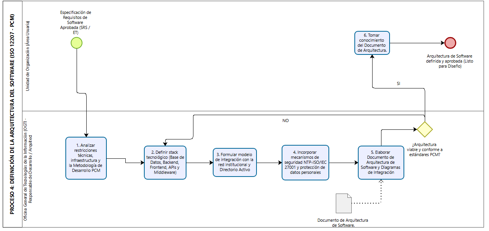
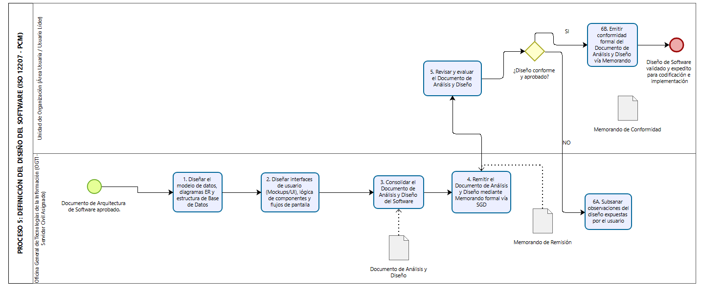
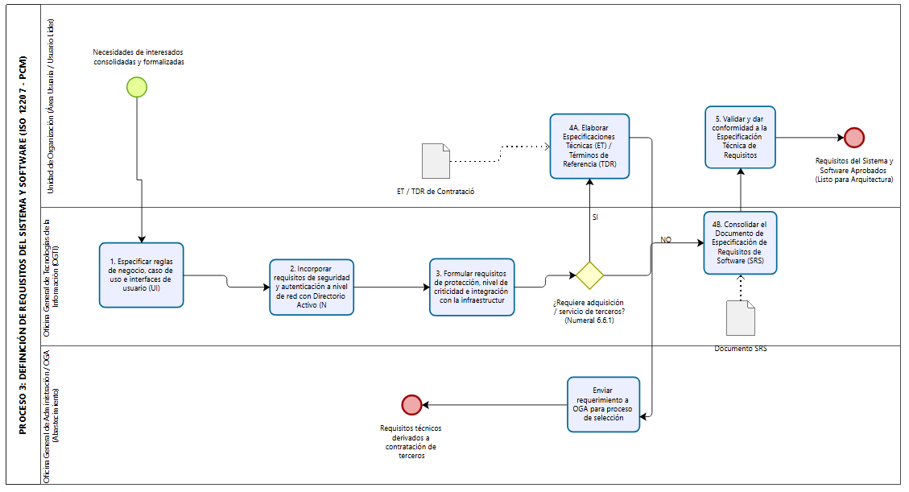
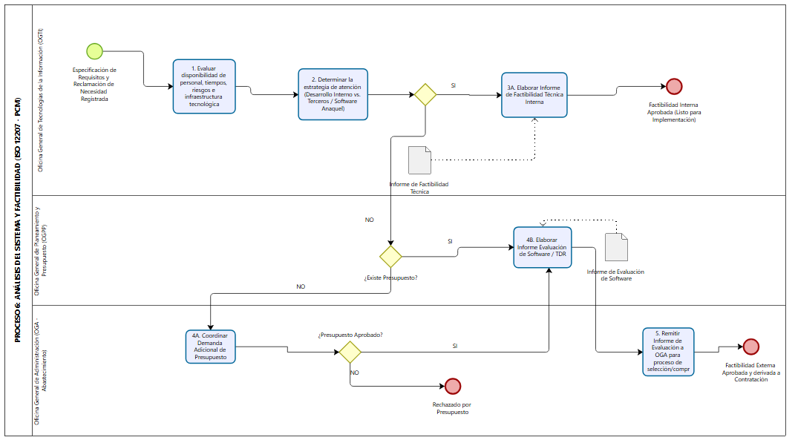
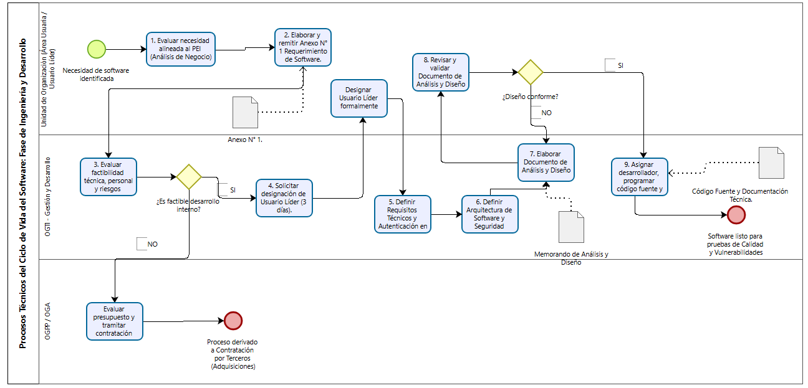

# ISO/IEC/IEEE 12207:2026 – Software Life Cycle Process Modeling for PCM

Proyecto académico de Ingeniería de Software orientado al análisis y propuesta de actualización de los procesos de gestión del ciclo de vida del software de la Presidencia del Consejo de Ministros del Perú (PCM).

La propuesta toma como referencia ISO/IEC/IEEE 12207:2026 y complementa el modelado de procesos con prácticas de seguridad de ISO/IEC 27001:2022 e ISO/IEC 27002:2022.

## Objetivo

Analizar la Directiva N.° 001-2023-PCM/SA/OGTI y proponer una estructura de procesos más detallada, trazable y alineada con prácticas actuales de ingeniería de software.

La propuesta considera:

- ISO/IEC/IEEE 12207:2026
- BPMN 2.0
- ISO/IEC 27001:2022
- ISO/IEC 27002:2022
- Gestión de requisitos
- Arquitectura y diseño de software
- Gestión de riesgos y calidad
- Seguridad de la información

## Problema analizado

La directiva vigente concentra varias actividades del ciclo de vida del software en un número reducido de macroprocesos.

El proyecto analiza oportunidades de mejora relacionadas con:

- trazabilidad de decisiones;
- definición clara de responsabilidades;
- gestión de requisitos;
- gestión de riesgos;
- arquitectura y diseño;
- control de versiones;
- seguridad;
- verificación y validación;
- evidencias documentales;
- modelado BPMN.

## Procesos técnicos modelados

### 1. Análisis de negocio o misión

### 2. Definición de necesidades y requisitos de los interesados

### 3. Definicion de la arquitectura

### 4. Definicion de diseno

### 5. Definición de requisitos del sistema/software

### 6. Analisis del sistema

### 7. Implementacion

## Modelado BPMN

Los procesos fueron representados mediante BPMN 2.0 utilizando:

- Pools
- Lanes
- Activities
- Gateways
- Events
- Data Objects
- Message Flows

Los carriles permiten distinguir responsabilidades entre actores como:

- Área Usuaria
- OGTI
- OGA
- OGPP
- responsables de desarrollo
- responsables de seguridad y calidad

## Seguridad

La propuesta complementa ISO/IEC/IEEE 12207:2026 con prácticas de ISO/IEC 27001 e ISO/IEC 27002 relacionadas con:

- control de acceso;
- autenticación;
- protección de datos;
- desarrollo seguro;
- pruebas de seguridad;
- gestión de vulnerabilidades;
- gestión de configuración;
- gestión de cambios;
- separación de ambientes;
- monitoreo.

## Tecnologías y conocimientos aplicados

- ISO/IEC/IEEE 12207:2026
- ISO/IEC 27001:2022
- ISO/IEC 27002:2022
- BPMN 2.0
- Bizagi Modeler
- Software Development Life Cycle
- Requirements Engineering
- Software Architecture
- Process Modeling
- Software Quality
- Information Security

## Resultados

El proyecto permitió transformar requisitos normativos y organizacionales en procesos visuales con responsables, decisiones y evidencias claramente identificables.

El principal aprendizaje fue comprender que una norma de ingeniería de software no debe copiarse literalmente dentro de una organización, sino adaptarse a sus procesos, actores, documentos y mecanismos de control.

## Contexto académico

Proyecto desarrollado como parte del curso de Calidad y Mejora de Procesos Software de la carrera de Ingeniería de Software.

## Disclaimer

Este repositorio corresponde a un proyecto académico y no representa una directiva oficial ni una posición institucional de la Presidencia del Consejo de Ministros del Perú.

Las normas ISO mencionadas son utilizadas únicamente como referencia. Sus contenidos completos no se distribuyen en este repositorio.

## Documentación

- [Informe completo en PDF](docs/informe-iso-12207-2026-pcm.pdf)
- [Versión editable en Word](docs/informe-iso-12207-2026-pcm.docx)

